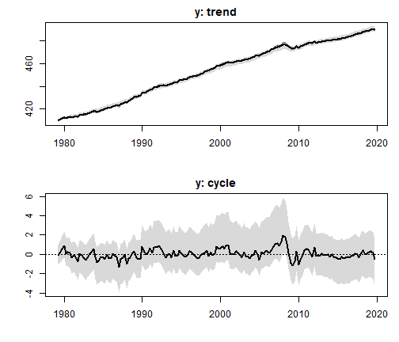
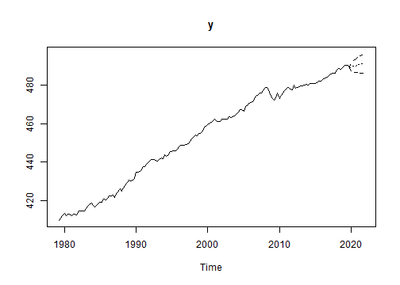

An unobserved components model splits a series into a stochastic trend and a
stationary cycle. For output, the cycle is an estimate of the output gap. This
vignette decomposes Austrian real GDP the way Grant and Chan (2017) decompose US
GDP: it estimates a few specifications of the trend and the shocks, compares them
by their integrated likelihood, and forecasts with the one that fits best.

## Data

Data set `at_gdp` holds the log of Austrian real GDP from 1979Q2. Times 100, the
increments of the trend are growth rates in percent per quarter. The sample ends
in 2019Q4, so that the pandemic quarters do not dominate the shock variances.


``` r
library(ucmtools)
#> Lade nötiges Paket: bayests
#> 
#> Attache Paket: 'ucmtools'
#> Das folgende Objekt ist maskiert 'package:stats':
#> 
#>     cycle

data("at_gdp")
y <- stats::window(at_gdp[, "y"], end = c(2019, 4)) * 100
```

## The model


``` r
set.seed(20261010)

model <- create_ucmodel(y, p = 2, iterations = 10000, burnin = 5000)
model <- add_priors(model, a = list(mu = c(1.3, -0.7), v_inv = 1))
model <- add_initial_values(model)
model <- add_posterior_coefficients(model)
model
#> Unobserved components model (UcNormalGamma)
#>   Series:     y
#>   Trend:      rw, drift on const
#>   Cycle:      var(2)
#>   Error:      gamma
#>   Draws:      10000 after a burn-in of 5000
#>   Simulated:  done
```

The trend is a random walk with a constant drift, the cycle an AR(2), and the two
shocks are independent: the model of Clark (1987). The prior on the cycle
coefficients is centred on a hump-shaped cycle, as in Grant and Chan (2017), and
like them `create_ucmodel()` draws the cycle stationary by default. Without that,
a share of the draws puts the cycle at a unit root, where it absorbs the slower
growth after 2008 and its band widens to several percent of GDP.


``` r
plot(model)
```

<div class="figure" style="text-align: center">

<p class="caption">plot of chunk clark-plot</p>
</div>

`trend()` and `cycle()` return the posterior bands of each component as a
time-series object:


``` r
gap <- cycle(model)
tail(round(gap, 2))
#>         lower median upper
#> 2018 Q3 -2.57   0.02  2.15
#> 2018 Q4 -2.47   0.08  2.28
#> 2019 Q1 -2.28   0.27  2.44
#> 2019 Q2 -2.39   0.33  2.46
#> 2019 Q3 -2.58   0.14  2.26
#> 2019 Q4 -3.37  -0.52  1.55
```

## Comparing specifications

Grant and Chan (2017) find that US output growth slowed in the mid-2000s, and
that a model with a break in the drift fits better than one without. The same
question for Austria: a break in 2008Q3, at the start of the financial crisis,
and correlated shocks, the model of Morley, Nelson and Zivot (2003).


``` r
variants <- list(
  "Clark" = model,
  "Break 2008Q3" = create_ucmodel(y, p = 2, breaks = list(c(2008, 3)),
                                  iterations = 10000, burnin = 5000),
  "Correlated" = create_ucmodel(y, p = 2, error = "gamma+covar",
                                iterations = 10000, burnin = 5000))

for (i in 2:3) {
  variants[[i]] <- add_priors(variants[[i]], a = list(mu = c(1.3, -0.7), v_inv = 1))
  variants[[i]] <- add_posterior_coefficients(add_initial_values(variants[[i]]))
}
variants <- lapply(variants, add_posterior_loglik)
```

The log likelihood of these models integrates the trend out, period by period,
as Grant and Chan (2017) do. A likelihood conditional on the drawn trend would
favour any model whose trend is allowed to move, since the trend can then absorb
the data. So WAIC and PSIS-LOO compare the specifications:


``` r
criteria <- lapply(variants, bayests::selection_criteria)
round(sapply(criteria, function(x) c(WAIC = x[["WAIC"]][["mean"]],
                                     LOOIC = x[["LOOIC"]][["mean"]])), 1)
#>       Clark Break 2008Q3 Correlated
#> WAIC  445.3        440.1      444.6
#> LOOIC 445.8        441.5      445.4
```

A lower value is a better fit. The drift's posterior gives the size of the
break:


``` r
summary(variants[["Break 2008Q3"]]$posterior$c$coeffs)$quantiles
#>                     2.5%        25%        50%        75%       97.5%
#> y.const        0.4546377  0.5383444  0.5807284  0.6236441  0.70997949
#> y.break2008q3 -0.5858681 -0.4130647 -0.3243195 -0.2372879 -0.07032649
```

## Forecasting

`add_forecast_input()` sets the horizon, and the drift carries on at its value in
the last period. `add_posterior_forecasts()` simulates one path per draw, and
`predict()` returns them in the form bayests plots:


``` r
best <- variants[["Break 2008Q3"]]
best <- add_forecast_input(best, n_ahead = 8)
best <- add_posterior_forecasts(best)
plot(predict(best))
```

<div class="figure" style="text-align: center">

<p class="caption">plot of chunk forecast</p>
</div>

The model has a seed, set by `add_initial_values()`, so the forecast repeats
draw for draw however R's generator stands.

## Other specifications

`create_ucmodel()` also takes a smooth trend (`trend = "smooth"`), an irregular
component (`irregular = TRUE`), an unrestricted shock covariance
(`error = "wishart"`), stochastic volatility (`error = "sv"`), skewed shocks
whose scales move with an index such as macroeconomic uncertainty
(`error = "skew"`, after Huang, Luo and Wang, 2026), and several series at once,
each with a trend and a cycle of its own.

A smooth trend with a white-noise cycle, `p = 0`, is the model behind the
Hodrick-Prescott filter (Hodrick and Prescott, 1997). Unlike the filter, the
model estimates the smoothing parameter, the ratio of the variance of the cycle
to that of the trend shock, rather than fixing it at 1600. The default priors
centre that ratio near one. A tight prior on the precisions of the shocks,
cycle first and trend second, centres it on 1600 instead:


``` r
s2 <- stats::var(diff(y))
hp <- create_ucmodel(y, p = 0, trend = "smooth", iterations = 10000, burnin = 5000)
hp <- add_priors(hp, u_sigma = list(shape = 100, rate = 100 * s2 * c(1, 1 / 1600)))
hp <- add_posterior_coefficients(add_initial_values(hp))
```

## References

Clark, P. K. (1987). The cyclical component of U.S. economic activity. *The
Quarterly Journal of Economics, 102*(4), 797--814.

Grant, A. L., & Chan, J. C. C. (2017). A Bayesian model comparison for
trend-cycle decompositions of output. *Journal of Money, Credit and Banking,
49*(2--3), 525--552.

Hodrick, R. J., & Prescott, E. C. (1997). Postwar U.S. business cycles: An
empirical investigation. *Journal of Money, Credit and Banking, 29*(1), 1--16.

Morley, J. C., Nelson, C. R., & Zivot, E. (2003). Why are the Beveridge-Nelson
and unobserved-components decompositions of GDP so different? *The Review of
Economics and Statistics, 85*(2), 235--243.
